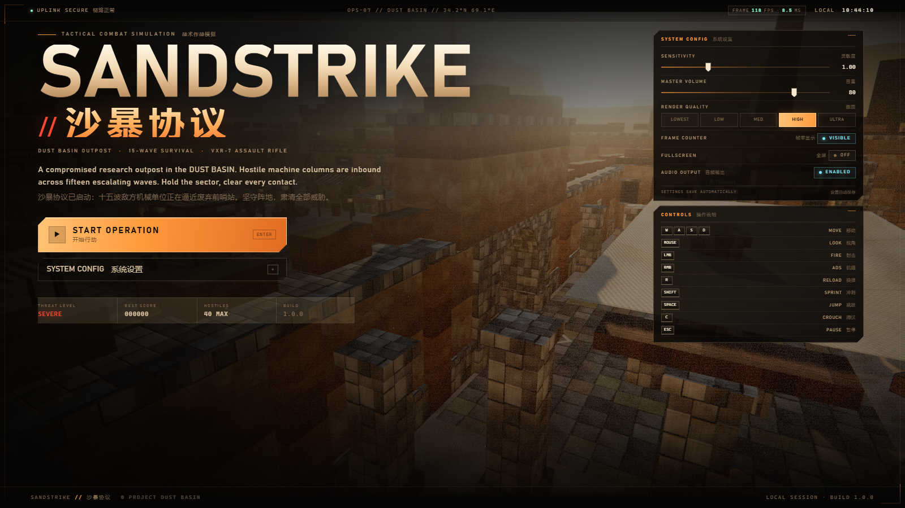
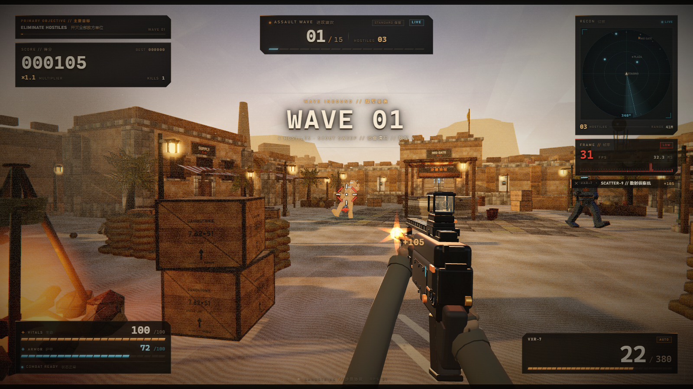
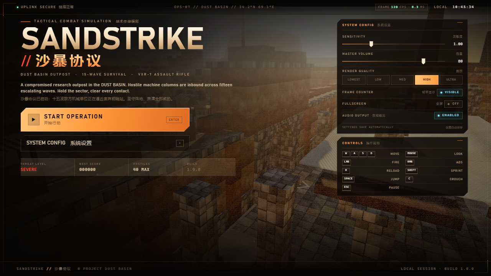
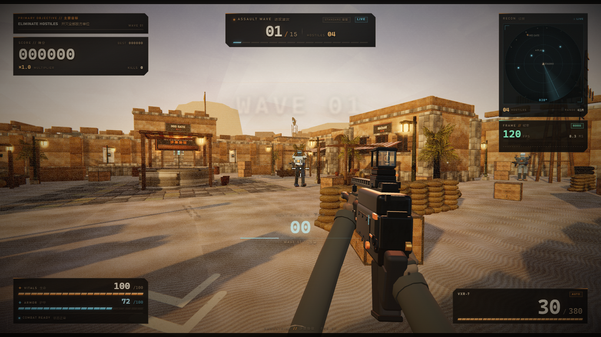

# SANDSTRIKE // 沙暴协议

一款完全自包含、使用 **Three.js** 制作的第一人称科幻射击 Demo。舞台是沙漠中的一座紧凑型沙漠二号风格前哨站，玩家孤身对抗 15 波机械军团。

> 无外部图片、模型、字体、音频或网络请求。所有贴图、模型、天空、特效与声音均在运行时由代码生成。Three.js 已本地内置，无需构建步骤；也可以打包成**双击即玩**的单文件 HTML（见下文）。

## 运行

```bash
node serve.mjs
```

然后用最新版 **Chrome / Edge** 打开：<http://127.0.0.1:8080>

> 如果 8080 已被其他程序占用（例如本机 Docker 应用），可换端口：
>
> ```powershell
> $env:PORT='8099'; node serve.mjs
> ```
>
> 然后打开 <http://127.0.0.1:8099>，并把同一地址传给 QA：`node scripts/qa.mjs http://127.0.0.1:8099`。

首次进入会短暂编译着色器。点击 **START OPERATION / 开始行动** 开始，浏览器会请求锁定鼠标；按 `Esc` 可随时暂停并释放鼠标。

### 操作

| 按键 | 功能 |
| --- | --- |
| `W A S D` | 移动 |
| 鼠标 | 观察 / 瞄准 |
| 鼠标左键 | 射击（VXR-7 自动步枪） |
| 鼠标右键 | 机瞄（ADS，FOV 收窄与镜头呼吸） |
| `Shift` | 冲刺 |
| `Ctrl` / `C` | 下蹲 |
| `Space` | 跳跃 |
| `R` | 换弹 |
| `F3` | 帧数显示开关 |
| `Esc` | 暂停 / 释放鼠标 |

### 移动端（手机 / 平板）

游戏支持触屏设备：在手机或平板上用浏览器打开同一地址即可，**无需安装、无需改地址**。触屏设备会自动启用虚拟摇杆与触摸按键，并默认以 MEDIUM 画质 + 自适应分辨率运行以保证帧率。

| 触屏操作 | 功能 |
| --- | --- |
| 左下虚拟摇杆 | 移动（推到边缘自动冲刺） |
| 右侧空白处拖动 | 观察 / 瞄准 |
| `FIRE` 按住 | 持续射击 |
| `ADS` 点按 | 开镜切换 |
| `RELOAD` 点按 | 换弹 |
| `JUMP` 点按 | 跳跃 |
| `CROUCH` 点按 | 蹲伏切换 |
| 右上暂停键 | 暂停 / 设置 |

> 建议**横屏**游玩：竖屏时主菜单仍可正常操作，进入战斗后会显示旋转提示。桌面端（键盘 + 鼠标 + 鼠标锁定）行为完全不变。

开发调试时可用 URL 参数强制开关触屏模式：`?touch=1` 在桌面上模拟触屏、`?touch=0` 强制桌面模式；`?quality=` 仍可覆盖移动端默认画质。移动端 HUD / 菜单采用独立紧凑布局，桌面分辨率下的外观保持不变。

目标：在 **15 波**机械单位进攻中生存。波次规模逐波递增（4 → 20 台，总计约 190 台），每 5 波出现一次 **KHARON-Ω WARLORD**（第 5 / 10 / 15 波）。每波结束会获得弹药、护甲与生命补给；爆头造成 2.3 倍伤害。

### 难度选择（DEPLOY 时选择）

点击 **START OPERATION / REDEPLOY** 后会先弹出部署面板选择难度：

| 难度 | 规则 |
| --- | --- |
| **标准 保留强化** | 死亡后**保留**已获得的掉落强化（弹匣/威力/换弹/减伤）与稀有装备带来的护甲、生命上限，重新部署继续变强 |
| **硬核 死亡不保留** | 死亡后**清空**全部强化与额外护甲/生命上限，每次重新部署都回到基础 VXR-7 + 100 护甲 + 100 生命 |

难度选择不放在设置里，而是每次部署时决定；当前模式会在 HUD 波次面板显示（`STANDARD 保留` / `HARDCORE 不保留`）。

## 单文件版（双击即玩）

不想启服务器时，可以生成一个完全自包含的 `sandstrike.html`：CSS、游戏代码和 Three.js 全部内联，**双击用 Chrome / Edge 打开即可运行**（无需 Node、无需网络、可直接拷贝/发送给别人）。

```bash
node scripts/build-standalone.mjs     # 等价于 npm run build:html
```

生成 `sandstrike.html`（约 1 MB）。验证它确实能像双击一样运行：

```bash
node scripts/verify-standalone.mjs    # 用 headless Chrome 以 file:// 打开并跑完 15 波
```

> 原理：浏览器禁止 `file://` 页面加载 ES Module（CORS），所以构建脚本用 esbuild 把 `src/main.js`（含 vendored Three.js 与 addons）打成 IIFE，再把 CSS/JS 内联进 `index.html`。源码与 `node serve.mjs` 的开发方式完全不受影响。构建脚本需要 `esbuild`（已列入 devDependencies）；静态服务与单文件产物本身都不需要它。

## 画面与技术

- **沙漠二号风格 mini 关卡**：68×68m 紧凑环形前哨，包含 A 点、A 大道、中门、B 通道、中央庭院、出生区与沙丘远景；一处关卡内可完成全部 15 波战斗
- **程序化 PBR 材质**：沙地风纹、土坯裂缝、石板、金属划痕、木箱、织物、双语涂装、墙面海报与地面贴花；天空、云、太阳与沙尘也由 shader 实时生成
- **HDR 渲染管线**：MSAA 半浮点目标 → UnrealBloom → 自定义电影级调色（ACES 色调映射、颗粒、暗角、色差、受击/低血量滤色）→ OutputPass
- **黄金时刻光照**：低角度西晒太阳、软阴影、PMREM 环境反射、灯笼与火焰的实际光源、体积感沙尘/热浪/风动布幔
- **程序化第一人称 VXR-7 视模**：分件式枪身、开放式红点镜、枪管/护木/弹匣/枪机、双手、枪带、枪口焰、抛壳、换弹与后坐动画
- **机器人军团**：SCATTER-9 侦察机、VULTURE-3 步枪机、BULWARK-7 重装机与 KHARON-Ω 监军；A* 网格寻路、视线检测、掩体走位、命中分区（头部/躯干/核心）与材质化登场
- **高密度反馈**：命中标记、击杀播报、弹着贴花、火花、沙尘、爆燃、冲击波、震屏、弹药与护甲拾取
- **战利品升级**：击毁机器人有概率掉落 **弹匣扩容（+5 发/个）**、**子弹威力（×1.05/个）**、**换弹加速（−12%/个）**；每 5 波的 WARLORD 必定掉落全套。HUD 弹药面板会实时显示 `MAG +N // DMG +X% // RLD -Y%`，弹匣刻度条也会随容量增长
- **稀有装备（1% 掉落）**：金色圣物，拾取后 **生命与护甲一起回满**，并永久 **+50 护甲上限**（硬核模式下随波次重置）
- **护盾模块（10% 掉落）**：青色六边形护盾，每次拾取 **受到的伤害 −5%**（可叠加，上限 −60%）；HUD 生命面板显示 `DR -X%`
- **生命核心（5% 掉落）**：绿色十字核心，拾取后 **生命上限 +10%**（提升上限的同时补满新增部分）；HUD 生命读数显示 `当前/上限` 与 `HP +N`
- **完全代码合成的 Web Audio**：沙漠风声、自适应战斗脉冲、枪声、机械脚步、换弹 foley、命中金属声、爆炸、UI 提示与胜利/死亡音乐，支持立体声声像与动态压缩
- **战术 HUD**：动态雷达（12Hz）、波次追踪、血量/护甲（含上限与掉落增益读数）、弹药、准星状态、方向受击指示、计分/连杀倍率、双语菜单与设置（灵敏度/音量/画质持久化、帧数显示、全屏切换）
- **帧数显示（FRAME COUNTER）**：HUD 右上（雷达下方）常驻帧率面板——FPS、平均帧时间（ms）、GOOD/FAIR/LOW 状态与最近 72 帧的帧时间柱状图；主菜单顶栏也有一行精简读数和颜色状态。默认开启，按 `F3` 或菜单/暂停 → SYSTEM CONFIG → `FRAME COUNTER` 开关，状态随设置自动保存

## 画质

设置中可切换 5 档画质（`LOWEST / LOW / MED / HIGH / ULTRA`），从内部分辨率、阴影、泛光、MSAA 到粒子/贴花预算逐级缩放；新增的 `LOWEST / LOW` 面向核显与老机器，`LOWEST` 关闭整条阴影与泛光渲染并以约 0.55× 内部分辨率渲染，帧率提升最明显。默认 1080p 及以上使用 `HIGH`，触屏设备默认 `MEDIUM`；短屏 1280×720 下菜单与 HUD 也有专门的紧凑布局。

| 档位 | 内部渲染比例（桌面） | 阴影贴图 | 泛光 | MSAA | 粒子/贴花预算 |
| --- | --- | --- | --- | --- | --- |
| **LOWEST 最低** | 0.55× | 关闭 | 关闭 | 关 | ~28% |
| **LOW 低** | 0.75× | 1024 | 0.18 | 2× | ~45% |
| **MEDIUM 中** | 1.0× | 2048 | 0.28 | 2× | ~62% |
| **HIGH 高** | 1.65×（受 DPR 上限） | 4096 | 0.40 | 4× | 100% |
| **ULTRA 极高** | 2.0×（受 DPR 上限） | 4096 | 0.50 | 4× | ~134% |

> 档位可随时在菜单 / 暂停 → SYSTEM CONFIG → RENDER QUALITY 切换并自动保存（旧存档的 MEDIUM/HIGH/ULTRA 选择不受影响）；`LOWEST` 额外关闭动态阴影与 bloom，适合核显/低端设备。移动端渲染像素比上限为 LOWEST 0.6 / LOW 0.8 / MEDIUM 1.0 / HIGH 1.25 / ULTRA 1.5。

### 帧数显示

HUD 右上方（侦察雷达下方）常驻 **FRAME / 帧率** 面板：整数 FPS、平均帧时间（ms）、`GOOD / FAIR / LOW` 状态灯，以及最近 72 帧的帧时间柱状图（含 16.7ms 60FPS 参考线），打开画质设置或排查掉帧时一眼可见；主菜单顶栏也有一行更精简的同源读数，方便直接对比 `LOWEST / LOW / MED / HIGH / ULTRA` 各档画质的帧率差异。

面板默认开启。按 `F3` 可在任何界面一键开关，也可以到菜单 / 暂停的 **SYSTEM CONFIG → FRAME COUNTER（帧率显示）** 切换；开关状态和其它设置一起保存在本地，刷新后保持。测量直接复用 UI 动画帧时钟（原始帧间隔、约 500ms 滚动窗口），显示刷新被限制在 8Hz 文本 / 14Hz 画布，对帧率基本零开销；切后台或长卡顿后会自动重置统计窗口，不会出现异常读数。

### 全屏

菜单 / 暂停 → **SYSTEM CONFIG → FULLSCREEN（全屏）** 可一键进入 / 退出浏览器全屏，按钮实时反映当前状态：`ON` 为绿色高亮、`OFF` 为中性沙色。全屏由浏览器原生 API 驱动，若通过浏览器自己的全屏快捷键或 `Esc` 退出全屏，开关会随 `fullscreenchange` 自动同步，不会出现"显示 ON 实际不是全屏"的错位；触屏设备（手机 / 平板）同样可用，可以隐藏浏览器地址栏获得更大视野。

全屏属于**浏览器会话状态**：`requestFullscreen()` 必须由用户手势触发，因此该开关不会写入本地设置，刷新后回到窗口模式，需要时再点一次即可（其余设置仍会自动保存）。

## 截图

| | |
| --- | --- |
|  |  |
| 主菜单 / 行动简报 | 第一波接敌 |
|  |  |
| VXR-7 开火 / 命中闪白 | 15 波完成 / SECTOR SECURED |
|  |  |
| 阵亡 / SIGNAL LOST | 1280×720 紧凑布局 |
|  | |
| 1280×720 游戏画面 | |
|  | |
| 帧数显示 / FRAME COUNTER：FPS · 帧时间 · GOOD/FAIR/LOW · 72 帧柱状图 | |

## 验证

```bash
node scripts/check.mjs             # 语法检查
node scripts/qa.mjs                # 无头 Playwright QA（需先启动服务）
node scripts/fps-probe.mjs         # 帧数显示黑盒验证（准确性/开关/持久化/布局）
node scripts/quality-probe.mjs     # 5 档画质黑盒验证（参数生效/持久化/布局/回归）
node scripts/fullscreen-probe.mjs  # 全屏开关黑盒验证（进入/退出/状态同步/布局）
node scripts/mobile-qa.mjs         # 移动端触屏 / 响应式 QA（需先启动服务）
node scripts/gpu-band-check.mjs    # 真实 GPU 上的黑块回归（需硬件加速）
node scripts/verify-standalone.mjs # 单文件 HTML 验证（file:// 直接打开）
```

> `qa.mjs` 默认用 SwiftShader 保证可复现；在这台机器上可用 `$env:QA_GPU='1'` 切到真实 D3D11 显卡（更快，截图里的帧数面板读数也更接近真机）。`fps-probe.mjs` 始终使用硬件 GPU（软件渲染的帧率噪声会淹没准确性断言）。

QA 会自动完成：真实点击 `START OPERATION` → 锁定鼠标 → 波次 1 生成 → 瞄准射击/命中/击杀 → 依次清除 15 波 → 胜利结算 → 重开 → 阵亡结算，并输出上方截图与 `shots/qa.json`。最终一次完整跑通为 **0 控制台错误**，5/5 波、30+ 击杀、胜利与阵亡界面均正常显示。

`fps-probe.mjs` 用黑盒断言验证帧数显示：HUD 与菜单读数与实际帧率（独立 `requestAnimationFrame` 计数）偏差 ≤15%、`fps × 帧时间 ≈ 1000`、默认可见且实时刷新、`F3` / 两处 SYSTEM CONFIG 开关 / `localStorage` 持久化、两处读数同步隐藏、1600×900 与 1280×720 下面板在视口内且不与雷达/准星重叠、15 秒战斗（含暂停恢复、`fastForward`、`freeze`）无 console error 且不逐帧写 DOM。结果写入 `shots/fps-probe.json` 与 `shots/fps-*.png`。

`fullscreen-probe.mjs` 用真实用户手势验证全屏开关：菜单与暂停两份 SYSTEM CONFIG 面板都有 FULLSCREEN 行、初始 `OFF`；点击后 `document.fullscreenElement` 就位且两面板 `ON` / `aria-pressed` / 高亮态同步，再次点击退出；外部（脚本或浏览器）退出全屏时开关自动跟随 `fullscreenchange` 复位；刷新后恢复窗口模式；1600×900 与 1280×720 设置面板不溢出、不遮挡 START/RESUME；移动端 844×390 触摸模拟可真实进入全屏；全程 0 console error 且不破坏游戏循环。结果写入 `shots/fullscreen-probe.json` 与 `shots/fullscreen-*.png`。

`quality-probe.mjs` 用真实点击验证 5 档画质：菜单 / 暂停各 5 个按钮（LOWEST→ULTRA）、默认 HIGH、双面板 active 与 `localStorage` 同步；逐档断言 `game/postfx/effects/enemies.quality`、`renderer.getPixelRatio()`（DPR1 下 0.55/0.75/1.0/1.0/1.0，DPR2 下 0.55/0.75/1.0/1.65/2.0）、阴影贴图 512/1024/2048/4096/4096 与 LOWEST 关阴影、泛光 null/0.18/0.28/0.40/0.50、MSAA 0/2/2/4/4；并覆盖 reload 持久化、`?quality=` 启动、游戏内实时切换、触屏 844×390、1600×900/1280×720 布局与 FPS/全屏回归。结果写入 `shots/quality-probe.json` 与 `shots/quality-*.png`。

`gpu-band-check.mjs` 用真实 GPU（ANGLE/D3D11）在 2476×1208 下连续射击 60 帧并逐列采样 framebuffer，断言不出现"整屏黑条"。这个问题只在硬件渲染下出现：曳光弹 shader 对可能略小于 0 的插值变量做 `pow()` 会产生 NaN，单个 NaN 像素被 bloom 的 mip 链扩散成大块黑区（SwiftShader 上不会复现）。修复方式是所有 `pow()` 前先 `clamp` 基值、整数次幂改为乘法，并在调色 pass 增加 NaN/Inf 兜底。

`verify-standalone.mjs` 则用 `file://` 打开单文件版，断言：无 module/CORS 报错、无任何网络请求、START 可点击进入游戏、渲染循环运行、15 波可通关，并把截图输出为 `shots/standalone-*.png`、结果写入 `shots/standalone-qa.json`。

`mobile-qa.mjs` 用 Playwright 的移动设备模拟（844×390 横屏 + 390×844 竖屏，DPR 3，`isMobile`/`hasTouch`）真实派发 CDP 触摸事件，断言：加载零控制台错误、主菜单开始按钮可点、虚拟摇杆能移动、右侧拖动可转向、FIRE 消耗弹药并在松手后停火、ADS / 换弹 / 跳跃 / 蹲伏 / 暂停全部生效、竖屏旋转提示、HUD 不溢出视口，并输出 `shots/mobile-*.png` 与 `shots/mobile-qa.json`。

## 移动端实现要点

- **触屏输入** `src/touch.js`：Pointer Events 多指手势（摇杆 + 转向 + 开火可同时进行）、自动冲刺、指针捕获、失焦/切后台自动松开所有按键；`?touch=1` 可在桌面模拟。
- **不锁鼠标**：触屏模式跳过了 Pointer Lock；桌面仍保留原有鼠标锁定逻辑。
- **性能策略**：触屏默认 MEDIUM 画质，渲染像素比按设备 DPR 收紧（LOWEST 0.6 / LOW 0.8 / MEDIUM 1.0 / HIGH 1.25 / ULTRA 1.5），并在运行中根据帧率动态调整内部渲染分辨率（0.72×～1.0×），画质设置里可手动覆盖。
- **响应式 UI**：`styles.css` 增加触屏层、安全区（刘海/home indicator）内边距、手机横/竖屏与平板媒体查询；HUD 采用紧凑布局，暂停键避开雷达，竖屏战斗显示旋转提示。

## 开发

- 静态服务：`node serve.mjs`
- 单文件构建：`node scripts/build-standalone.mjs`（产物 `sandstrike.html`）
- 语法检查：`node scripts/check.mjs`
- 无头 QA / 截图：`node scripts/qa.mjs`（需先启动服务）
- 真实 GPU 黑块回归：`node scripts/gpu-band-check.mjs`（需先启动服务）
- 帧数显示验证：`node scripts/fps-probe.mjs`（需先启动服务，硬件 GPU）
- 单文件验证：`node scripts/verify-standalone.mjs`
- 调试参数：`?dev=1` 暴露 `window.__sandstrike`；`?quality=lowest|low|medium|high|ultra` 强制画质
- 帧数统计（`?dev=1`）：`__devUI.perf` 读取 `{fps, frameMs, worstMs, samples, level}`，`__devUI.setShowFps(bool)` 切换面板；游戏内 `F3` 等同 SYSTEM CONFIG 开关
- 开发调试：`__sandstrike.fastForward(sec)`、`killAll()`、`jumpToWave(n)`、`freeze(true)`、`renderOnce()`
- 运行时依赖仅 `three`（已本地 vendored）以及 Node 静态服务器，**跑游戏不需要 npm install**；只有重新构建单文件版才需要 devDependencies 中的 `esbuild`（`npm install` 后可用）
