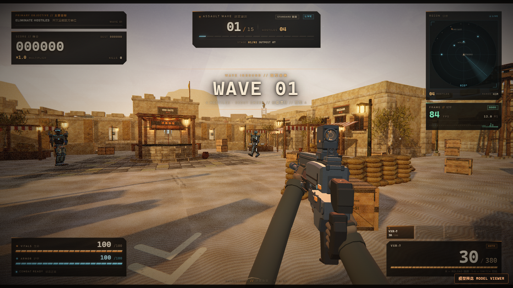
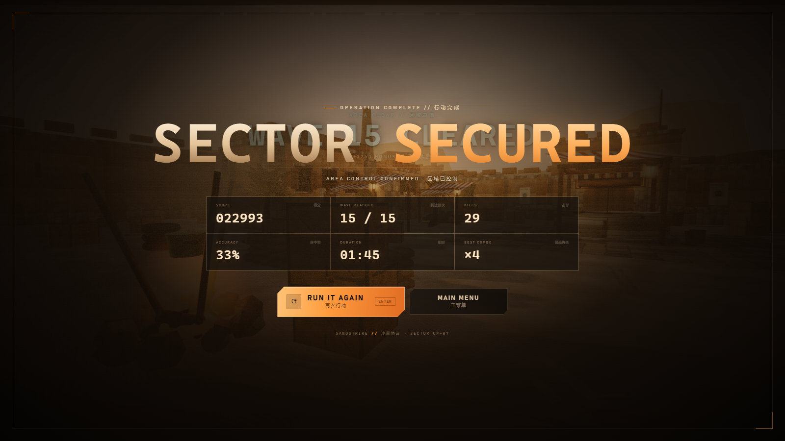
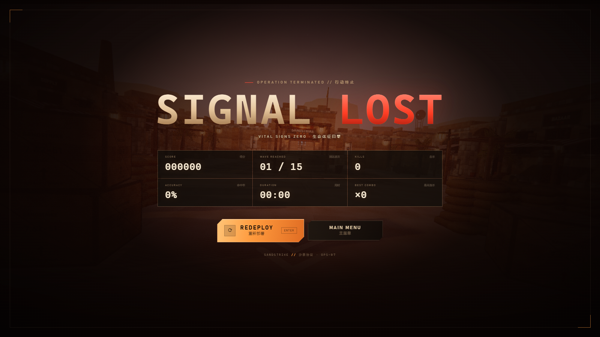
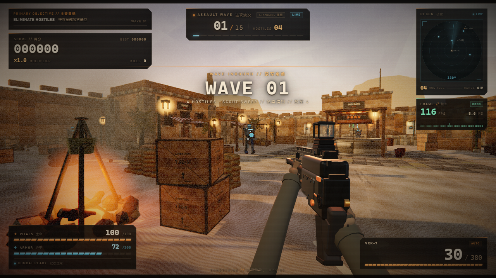

# SANDSTRIKE // 沙暴协议

一款完全自包含、使用 **Three.js** 制作的第一人称科幻射击 Demo。舞台是沙漠中的一座紧凑型沙漠二号风格前哨站，玩家孤身对抗 15 波机械军团；每 5 波降临一台 **SIEGE WARDEN 攻城督军**，击破后有概率掉落新武器。战役按关卡推进，每个关卡拥有独立存档与解锁标记。

> 无外部图片、模型、字体、音频或网络请求。所有贴图、模型、天空、特效与声音均在运行时由代码生成。Three.js 已本地内置，无需构建步骤；也可以打包成**双击即玩**的单文件 HTML（见下文）。

## 运行

```bash
node serve.mjs
```

然后用最新版 **Chrome / Edge** 打开：<http://127.0.0.1:8080>

> 如果 8080 已被其他程序占用（例如本机 Docker 应用），可换端口：
>
> ```powershell
> $env:PORT='8099'; node serve.mjs
> ```
>
> 然后打开 <http://127.0.0.1:8099>，并把同一地址传给 QA：`node scripts/qa.mjs http://127.0.0.1:8099`。

首次进入会短暂编译着色器。主菜单提供 **NEW GAME 新游戏 / CONTINUE 继续 / SELECT STAGE 选择关卡**；开始前在部署面板选择难度，进入关卡后浏览器会请求锁定鼠标；按 `Esc` 可随时暂停并释放鼠标。

### 操作

| 按键 | 功能 |
| --- | --- |
| `W A S D` | 移动 |
| 鼠标 | 观察 / 瞄准 |
| 鼠标左键 | 射击（当前武器：VXR-7 / RPG-7 / 加特林 / 霰弹枪） |
| 鼠标滚轮 | 循环切换武器 |
| `1` `2` `3` `4` | 直接切换武器槽（VXR-7 / RPG-7 / 加特林 / 霰弹枪） |
| 鼠标右键 | 机瞄（ADS，FOV 收窄与镜头呼吸） |
| `Shift` | 冲刺 |
| `Ctrl` / `C` | 下蹲 |
| `Space` | 跳跃 |
| `R` | 换弹 |
| `F3` | 帧数显示开关 |
| `Esc` | 暂停 / 释放鼠标 |

> 也完整支持**游戏手柄**（Xbox / PlayStation / Switch Pro / 标准映射手柄），并支持纯手柄游玩：见下节。

### 手柄（控制器）

支持 **Xbox / PlayStation / Switch Pro 以及大多数标准映射手柄**（USB 或蓝牙）。需要浏览器支持 Gamepad API（Chrome / Edge 均已支持），`node serve.mjs` 开发模式与双击即玩的单文件版都可使用。手柄插入后会被自动识别，无需任何设置；**从主菜单到战斗、暂停、结算都可以只用一只手柄完成**。游戏中拔掉手柄会自动暂停，避免角色停在原地挨打。

| 手柄按键 | 功能 |
| --- | --- |
| 左摇杆 | 移动（推满方向由 `LB` / `L3` 触发冲刺） |
| 右摇杆 | 观察 / 瞄准（有机瞄减速） |
| `RT` | 射击（扳机模拟量，按住持续开火） |
| `LT` | 机瞄 ADS（按住） |
| `A` | 跳跃；菜单 / 部署面板中为确认 |
| `B` | 蹲伏切换；菜单中为返回 |
| `X` | 换弹 |
| `RB` / 十字键左右 | 循环切换已携带武器（4 把武器槽） |
| `LB` / `L3` | 冲刺（按住） |
| `START` / `OPTIONS` | 战斗中暂停 / 继续；菜单 / 结算界面中为确认（等同 `A`） |
| `BACK` / `View` | 菜单返回 |
| `D-PAD` / 左右摇杆 | 菜单焦点移动（`A` 确认、`B` 返回、摇杆左右可调滑杆） |

- 手柄连接后：**SYSTEM CONFIG 二级菜单**里的 **CONTROLS** 图例自动切换为手柄按键，`START / RESUME / REDEPLOY` 等按钮与 HUD 换弹提示同步换成手柄提示；SYSTEM CONFIG 中新增 **CONTROLLER（手柄）** 状态行与 **VIBRATION（震动反馈）** 开关（默认开启，设置自动保存）。PlayStation 手柄会显示 `✕ / ○ / □ / △` 图例。
- 手柄开火 / 命中 / 击杀 / 受击带震动反馈，可在 SYSTEM CONFIG 中关闭。
- 手柄开始游戏时不需要鼠标点击，也不会弹出「鼠标锁定失败」提示；想切回鼠标时直接点击画面即可重新指针锁定，键鼠与手柄可随时混用。
- 多个手柄同时连接时使用第一个；中途断开会在下一帧自动暂停并提示 `CONTROLLER LOST // 手柄已断开`。
- 调试参数：`?gamepad=0` 禁用游戏手柄层（用于回归测试）；`?dev=1` 时可用 `__sandstrike.gamepad.getState()` 查看手柄状态。


### 移动端（手机 / 平板）

游戏支持触屏设备：在手机或平板上用浏览器打开同一地址即可，**无需安装、无需改地址**。触屏设备会自动启用虚拟摇杆与触摸按键，并默认以 MEDIUM 画质 + 自适应分辨率运行以保证帧率。

| 触屏操作 | 功能 |
| --- | --- |
| 左下虚拟摇杆 | 移动（推到边缘自动冲刺） |
| 右侧空白处拖动 | 观察 / 瞄准 |
| `FIRE`（右侧主开火键）按住 | 持续射击 |
| `FIRE`（左侧副开火键）按住 | 持续射击（左右手都能开火，可双键同时按） |
| `ADS` 点按 | 开镜切换 |
| `RELOAD` 点按 | 换弹 |
| `SWITCH` 点按 | 循环切换已携带武器 |
| `JUMP` 点按 | 跳跃 |
| `CROUCH` 点按 | 蹲伏切换 |
| 右上暂停键 | 暂停 / 设置 |

> 按键布局参考使命召唤手游（CODM）：主开火键位于屏幕右侧中部，JUMP / CROUCH 贴屏幕下边缘，RELOAD / ADS 在开火键右上方，左侧另有一颗镜像开火键，方便左手开火、右手瞄射。

> 建议**横屏**游玩：竖屏时主菜单仍可正常操作，进入战斗后会显示旋转提示。桌面端（键盘 + 鼠标 + 鼠标锁定）行为完全不变。

开发调试时可用 URL 参数强制开关触屏模式：`?touch=1` 在桌面上模拟触屏、`?touch=0` 强制桌面模式；`?quality=` 仍可覆盖移动端默认画质。移动端 HUD / 菜单采用独立紧凑布局，桌面分辨率下的外观保持不变。

## 战役：波次 / Boss / 难度 / 存档

一局游戏 = 一个**关卡（stage）**：完整打满该关的 15 波敌人。关卡、波次组合、Boss 规则、难度倍率、武器与敌人数值全部写在 `src/config/` 配置里（见下方「配置驱动」），代码只读取配置。

### 波次与 Boss（配置驱动）

- 波次组合来自 `src/config/waves.js` 的 `STAGE_WAVES`：每条 = `comp`（机型 → 数量）+ `label`（双语播报）。当前关卡共 **15 波**，规模逐波递增（4 → 20 台，总计约 190 台）。
- **每 5 波（第 5 / 10 / 15 波）出一只 Boss**：规则由 `WAVE_RULES` 配置——`bossEvery: 5`、`bossType: 'boss'`、`bossCount: 1`、`bossReplaces: ['warlord']`；运行时会先从该波组合移除监军，再在最后加入 1 台 **SIEGE WARDEN / 攻城督军**（5.35m 高的攻城机甲），并延迟 `bossSpawnDelay` 秒登场。
- Boss 登场 / 受伤 / 击破分别广播 `boss:spawn` / `boss:health`（≤10Hz）/ `boss:defeated`；HUD 底部中央显示带名称的 Boss 血条。Boss 血量按波次与难度缩放（STANDARD 第 5 波约 2166）。
- 击破 Boss 会固定掉落全套补给（弹药 / 生命 / 弹匣 / 威力 / 换弹），并**按概率掉落新武器**（见下）。
- 想改 Boss 波位置 / 数量 / 替换机型，只改 `WAVE_RULES`；想改某波敌人组合，只改 `STAGE_WAVES`，不需要动 `src/enemies.js`。

### 武器掉落与 4 把武器

玩家开局只有 **VXR-7 突击步枪**，其余 3 把只能从 Boss 掉落中获得：

| 武器 | 定位 | 获得方式 | 开火模式 |
| --- | --- | --- | --- |
| **VXR-7** 突击步枪 | 全能自动步枪 | 初始携带 | `auto` 全自动 hitscan |
| **RPG-7** 火箭筒 | 单发高爆 | Boss 掉落 | `rocket` 真实弹丸 + 范围爆炸（RPG 溅射走 `enemies.damageArea()`） |
| **M-77** 加特林机枪 | 持续压制 | Boss 掉落 | `spinup` 预转 0.55s 后 1150 RPM |
| **SG-12** 战术霰弹枪 | 近距爆发 | Boss 掉落 | `pump` 8 弹丸、距离衰减 |

- 掉落概率与数量在 `src/config/game.js`：`loot.bossWeaponDropChance: 0.05`（默认 5%）、`loot.bossWeaponDropCount: 1`；Boss 死亡只 roll 一次。
- 武器掉落以**地面悬浮模型 + 光柱**表现，玩家走近（<2m）自动拾取；HUD 右下出现 4 个武器槽，`1` / `2` / `3` / `4` 直接切换、鼠标滚轮循环、手柄 `RB` / 十字键左右循环、触屏 `SWITCH` 按钮循环。
- 最多携带 **4 把**（`MAX_WEAPON_SLOTS`）：槽满时拾取会替换当前武器槽，每把武器有独立弹匣 / 备弹 / 换弹 / 强化。数值全部在 `src/config/weapons.js` 的 `WEAPON_STATS`。

### 难度选择（4 档）

难度在**新游戏 / 选择关卡**时通过部署面板选择（不放在 SYSTEM CONFIG 里），并写入该关卡的存档：

| 难度 | 敌人血量 | 敌人伤害 | 说明 |
| --- | --- | --- | --- |
| **RECRUIT 新兵** | ×0.5 | ×0.5 | 熟悉地图与流程 |
| **STANDARD 标准** | ×1.0 | ×0.75 | 推荐首次通关 |
| **VETERAN 老兵** | ×2.0 | ×1.0 | 需要善用掩体与强化 |
| **NIGHTMARE 噩梦** | ×4.0 | ×2.0 | 四倍血量、双倍伤害；Boss 战极其漫长 |

- 难度**只影响敌人血量与对玩家伤害**，不改变敌人速度 / 精度（速度与精度只随波次成长）；倍率定义在 `src/config/difficulty.js`。
- 部署面板文案、HUD 波次面板的难度标签都读同一份配置；`getDifficulty(id)` 对未知 id 回落到 STANDARD。

### 关卡与存档（多关卡）

- 战役由 `src/config/stages.js` 的 `STAGES` 定义；**每个关卡一份独立存档 + 一个解锁标记**，由 `src/save.js` 统一读写（localStorage key `sandstrike.progress.v2`）。当前版本 2 个关卡（OUTPOST 07 沙暴前哨 / ATOLL 09 碧潮环礁），往 `STAGES` 里加一条（+ 可选新地图 / 波次表）即可自动获得新存档槽、解锁与选关卡片。
- 主菜单：**NEW GAME 新游戏**（清档 → 第 1 关 → 选难度）、**CONTINUE 继续**（回到上次进度 / 下一个未通关关卡）、**SELECT STAGE 选择关卡**（未解锁关卡锁定；选关时继承上一关结束时的武器、武器强化、护甲 / 生命上限加成与减伤）。
- **只在两个时刻写盘**：进入关卡时（关卡起始快照）与关卡通关时（结束快照 + 解锁下一关）。死亡、暂停、返回菜单、中途退出都**不写存档**；死亡后的 **REDEPLOY 重新部署** 用本关起始快照重开，保证重开不会重复叠加强化。
- 结算界面区分 `STAGE CLEAR // 关卡通过` 与 `CAMPAIGN COMPLETE // 战役完成`，并显示 `NEXT STAGE UNLOCKED // 已解锁下一关`。

## 单文件版（双击即玩）

不想启服务器时，可以生成一个完全自包含的单文件 HTML：CSS、游戏代码和 Three.js 全部内联，**双击用 Chrome / Edge 打开即可运行**（无需 Node、无需网络、可直接拷贝/发送给别人）。

```bash
npm run build:html                    # 等价于 node scripts/build-standalone.mjs
```

产物是 **`dist/sandstrike.html`**（约 1.7 MB，含内置地图 JSON、4 把武器模型与 Boss）。`dist/` 是构建产物目录、已 gitignore，不提交到仓库。验证它确实能像双击一样运行：

```bash
node scripts/verify-standalone.mjs    # 等价于 npm run qa:standalone；默认校验 dist/sandstrike.html，用 headless Chrome 以 file:// 打开并跑完 15 波
```

> 原理：浏览器禁止 `file://` 页面加载 ES Module（CORS），所以构建脚本用 esbuild 把 `src/main.js`（含 vendored Three.js 与 addons）打成 IIFE，再把 CSS/JS 内联进 `index.html`。源码与 `node serve.mjs` 的开发方式完全不受影响。构建脚本需要 `esbuild`（已列入 devDependencies）；静态服务与单文件产物本身都不需要它。

## 配置驱动（src/config/）

关卡、波次、Boss、难度、敌人属性、武器与战利品数值全部集中在 `src/config/`，改数值不需要动代码：

| 文件 | 内容 | 关键导出 |
| --- | --- | --- |
| `src/config/index.js` | 统一出口（运行时只从这里 import 配置） | `CONFIG` + `getDifficulty` / `resolveWave` / `WEAPON_STATS` / `STAGES` 等 re-export |
| `src/config/game.js` | 渲染 / 玩法调参、波次间隔、战利品与 Boss 武器掉落概率 | `CONFIG.waves`、`CONFIG.loot.bossWeaponDropChance` / `bossWeaponDropCount` |
| `src/config/difficulty.js` | 4 档难度倍率（只影响敌人血量与伤害） | `DIFFICULTIES`、`getDifficulty(id)`、`DEFAULT_DIFFICULTY_ID` |
| `src/config/waves.js` | 15 波组合 + Boss 波合成规则 | `WAVE_RULES`、`STAGE_WAVES`、`resolveWave(stageId, wave)`、`expandComposition` |
| `src/config/stages.js` | 关卡目录（每关一份存档 / 解锁 / 选关） | `STAGES`、`getStage(id)`、`nextStage(id)`、`stageWaves(stage)` |
| `src/config/weapons.js` | 4 把武器数值（含爆炸 / 霰弹 / 预转参数） | `WEAPON_ORDER`、`WEAPON_STATS`、`MAX_WEAPON_SLOTS`、`getWeaponStats(id)` |
| `src/config/enemies.js` | 5 种机体的血量 / 单发伤害（含 Boss 调参） | `ENEMY_STATS` |
| `src/config/maps/` | 地图数据：一张地图一个文件夹（下一节） | `MAP_SOURCES`、`DEFAULT_MAP_ID` |

> `node scripts/check.mjs` 会静态校验这些配置的契约（难度倍率表、`WAVE_RULES.total` 与波表长度、Boss 波合成、关卡链与地图 id、4 把武器的必需字段）以及 `src/save.js` 的纯 Node 存档往返 / 容错；配置写崩会直接让 CI 失败。

## 关卡数据（多地图）

关卡（地图）数据与构建代码分开存放：`src/config/` 放配置，`src/world/` 放"读数据并建世界"的代码。**一张地图 = `src/config/maps/` 下的一个文件夹**，内部由多个可组合 JSON 部件拼成，加载器按 `map.json` 的 `format` 字段分派格式适配器。

```
src/
  config/                     # 所有配置（原 src/config.js 也搬到了这里）
    index.js                  # CONFIG 统一出口
    game.js                   # 游戏 / 渲染调参
    maps/                     # 地图配置根目录：一张地图一个文件夹
      index.js                # 地图注册表（静态 import 每张地图的 JSON 部件）
      README.md               # 关卡 JSON 格式说明 + 新增地图步骤
      outpost-07/             # 地图 1：OUTPOST 07（沙暴前哨，默认地图，format sandstrike/map@1）
        map.json              # 清单：format / id / name / bounds / playerSpawn / parts
        terrain.json          # 地形：地面 / 石板 / 沙丘 / 远山 / 天际线 / 远景雾面
        environment.json      # 天空 / 太阳 / 雾 / 灯光 / 环境反射 / 氛围
        architecture.json     # 建筑布局 + 结构碰撞附加
        props.json            # 道具 / 英雄道具布局 + 道具碰撞附加
        dressing.json         # 站点级贴花 / 海报 / 灯笼 / 点光 / 横幅清单
        spawns.json           # 敌人生成候选点 / 地标 / 出生点解析参数
      test-range/             # 地图 2：TRAINING RANGE（44×44m 训练靶场，格式示例/模板）
      island-01/              # 地图 3：ATOLL 09（碧潮环礁，format sandstrike/map@2）
        map.json              # 清单：format / id / name / bounds(±70) / playerSpawn / parts
        terrain.json          # 岛形：草地半径 / 沙滩环 / 海底坡 / 环礁岩脊边界 / 海水参数
        environment.json      # 清晨天空 / 低角度阳光 / 湿雾 / 半球光 / pollen+mist 氛围
        architecture.json     # 村庄 / 遗迹 / 海岸结构摆放（碰撞盒由格式适配器按 footprint 派生）
        props.json            # 植被 + 复用道具摆放（实体植被树干有碰撞，灌木/蕨/草/藤可穿过）
        dressing.json         # 氛围覆盖（pollen/mist/birds 数量）
        spawns.json           # 玩家出生 / 22 个敌人候选 / 9 个地标 / 解析参数
  world/                      # 世界构建代码（布局/地形/环境数值来自 JSON）
    index.js                  # createWorld()：加载地图 → 按 style 走前哨或海岛构建链
    island-terrain.js         # 海岛地面：草地/沙滩/海底/环礁岩脊（视觉与碰撞同源）
    island-water.js           # 海面 shader + 岸边白浪
    island-ambience.js        # 花粉浮尘 / 低空薄雾 / 海鸟
    island-props.js           # 25 个岛图模型 + 复用道具的静态装配
    island-shape.js           # 岛形数学（环礁边界分段 / 碰撞环），纯数据、无 three
    data/                     # 数据层：格式分派（map@1/map@2）、校验、碰撞推导、出生点解析
    terrain.js / architecture.js / props.js / dressing.js / ambience.js / update.js / ...
```

- **换地图**：`?map=<id>`，例如 <http://127.0.0.1:8080/?map=outpost-07>、<http://127.0.0.1:8080/?map=island-01>；未知 id 会 `console.warn` 并回落到默认地图。默认地图是 `outpost-07`（`src/config/maps/index.js` 的 `DEFAULT_MAP_ID`）。**直接进某个关卡**用 `?stage=<id>`（自动切到该关卡的地图），例如 <http://127.0.0.1:8080/?dev=1&stage=island-01>。
- **加一张地图**：复制 `src/config/maps/outpost-07/` 为 `<new-id>/` → 改 `map.json`（`id` 必须等于文件夹名）和各 JSON 部件 → 在 `src/config/maps/index.js` 里静态 import 并在 `MAP_SOURCES` 注册一行。字段含义、派生规则（如木箱/油桶碰撞尺寸）与格式约定见 **`src/config/maps/README.md`**。
- **格式与扩展**：`sandstrike/map@1`（沙漠前哨，`src/world/data/formats/v1.js`）与 `sandstrike/map@2`（热带海岛，`src/world/data/formats/v2.js`）。数据层按 `format` 分派适配器；map@2 的岛屿地图只写"摆放"，碰撞盒按 `ISLAND_MAP_SPEC.md §3` 的 footprint 表自动派生（含结构/复用掩体/**实体植被树干**碰撞与 r=52 的环礁岩脊边界环）。新增格式只需加一个适配器 + 在 `ADAPTERS` 注册。
- **校验**：
  - `node scripts/world-verify.mjs --tag=<name>` 抓取世界数据 + 固定相机截图（`?dev=1`、raw render），`--compare=<a>,<b>` 对两份抓取做数据逐元素比较与截图像素差比较；输出在 `.scratch/maps-refactor/verify/<tag>/`（gitignored）。
  - `npm run check:maps` 校验所有地图 JSON（格式 / id / parts / 碰撞体 / 出生点 / 注册表完整性），并回归 island 植被碰撞边界（实体植被必须有树干碰撞盒、软植被必须无碰撞盒、盒宽不得失控）；
  - `node scripts/check.mjs` 做静态语法/引用检查，并校验 `src/config/` 的配置契约（难度 / 波次 / 关卡 / 武器）与 `src/save.js` 的纯 Node 存档往返 / 容错。
- **等价性**：本次拆分用固定相机 + 数据指纹验证——`collisionBoxes` / 出生点 / 地标 / `layout` 逐元素与拆分前一致，6 张固定视角截图平均像素差 **0.0002% ~ 0.18%**（仅布幔/沙尘动画相位差异）。
- **已知限制 / Roadmap**：`outpost-07`（map@1）仍有少数"站点级"装饰由模型构建器代码按绝对坐标生成（boundary 的垛口/旗帜、B 隧道顶棚/灯/牌、pipeline、looseProps、siteBanners）；新地图把门楼/柱廊/方尖碑对齐到这些坐标即可规避（`test-range` 的做法）。**`sandstrike/map@2` 已落地**：热带岛屿地图 `island-01` 用独立的岛图构建链（地形/海水/氛围/25 个岛图模型），不再依赖前哨代码里的硬编码坐标；前哨的老装饰数据化留待后续把 map@1 也升级。细节见 `src/config/maps/README.md` 与 `ISLAND_MAP_SPEC.md`。

## UI 结构（按功能区域拆分）

UI 不再是一个巨型 `src/ui.js`，而是按功能区域拆到 `src/ui/` 下，主入口为 `src/ui/index.js`：

```
src/ui/
  index.js      # UI 核心：状态机/屏幕切换、settings 存储与 setter、动作、键盘+手柄、rAF 循环
  shared.js     # 常量、数据表（操作说明/提示/统计行）与纯函数、bus 订阅助手
  hud.js        # 战斗 HUD：生命/护甲、弹药、波次、雷达、准星、击杀播报、横幅/提示
  home.js       # 加载界面 + 首页（标题、START、最佳分数、时钟）
  settings.js   # 二级菜单 SYSTEM CONFIG：设置面板 + CONTROLS 操作说明 + 打开/关闭
  overlays.js   # 暂停 / 死亡 / 胜利结算 / 部署难度弹窗
  perf.js       # 帧数计（HUD 右上角面板 + 首页顶栏读数）
```

- **首页只保留主操作**：设置与操作说明不再直接铺在首页（原来的右侧边栏），而是收进 **SYSTEM CONFIG 二级菜单**——首页点 `SYSTEM CONFIG 系统设置` 打开，`ESC` / 右上角 ✕ / 点遮罩关闭；暂停界面同样从这里打开。开关状态照旧自动保存到 `localStorage`。
- 面板只负责自己的 DOM/渲染与局部 bus 订阅；全局点击/输入委托、屏幕切换、设置持久化和 `ui:*` 事件都在 `index.js`。`src/gamepad.js` 的菜单焦点导航把二级菜单当作与部署弹窗同级的焦点区（打开时焦点自动落到关闭按钮，`B`/`ESC` 优先关闭二级菜单）。
- `npm run check` 会校验 `src/ui/` 各功能模块都存在且旧 `src/ui.js` 已被移除。

## 画面与技术

- **热带孤岛关卡（map@2，`island-01` ATOLL 09）**：四面环水的封闭小岛（可玩陆地 ≈ 2× 沙漠图，总占地 140×140m），环形草地高原 → 沙滩环 → 环礁岩脊边界 → 浅海/深海；**雨林树 63 株成丛 + 椰林/竹丛/芭蕉/蕨类/垂藤/灌木/草簇密布**，草原不再空旷；**1.25m 石垒矮墙 + 货箱/木桶/摊位等真实碰撞掩体**沿动线布置；茅草干栏村（4 茅屋+3 破屋）、**多房间神殿遗迹群**（南门拱→六柱柱廊→外庭石像→内门拱→内殿石像→后殿围合，东西侧室 + 石塔 + 16 石柱 + 倒柱掩体）、木栈桥/独木舟/沉船残骸；**清晨蓝调天空 + 大量湿雾与空气散射**（天顶蓝、地平湿雾密度 0.0076、5 条低空雾带、花粉 460、海鸟 6）、海面菲涅尔/日光碎金/岸边白浪；15 波、每 5 波 Boss。碰撞盒由地图摆放自动派生（含环礁边界环），共 251 盒。
- **沙漠二号风格 mini 关卡**：68×68m 紧凑环形前哨，包含 A 点、A 大道、中门、B 通道、中央庭院、出生区与沙丘远景；一处关卡内可完成全部 15 波战斗
- **程序化 PBR 材质**：沙地风纹、土坯裂缝、石板、金属划痕、木箱、织物、双语涂装、墙面海报与地面贴花；天空、云、太阳与沙尘也由 shader 实时生成
- **HDR 渲染管线**：MSAA 半浮点目标 → UnrealBloom → 自定义电影级调色（ACES 色调映射、颗粒、暗角、色差、受击/低血量滤色）→ OutputPass
- **黄金时刻光照**：低角度西晒太阳、软阴影、PMREM 环境反射、灯笼与火焰的实际光源、体积感沙尘/热浪/风动布幔
- **程序化第一人称 VXR-7 视模**：分件式枪身、开放式红点镜、枪管/护木/弹匣/枪机、双手、枪带、枪口焰、抛壳、换弹与后坐动画
- **4 把可携带武器**：VXR-7 全自动、RPG-7 火箭筒（真实弹丸 + 范围爆炸溅射）、M-77 加特林（预转后 1150 RPM）、SG-12 霰弹枪（8 弹丸 / 距离衰减）；每把独立弹匣、备弹、换弹与强化，`1-4` / 滚轮 / 手柄 / 触屏切换，HUD 右下角显示 4 个武器槽
- **机器人军团**：SCATTER-9 侦察机、VULTURE-3 步枪机、BULWARK-7 重装机、KHARON-Ω 监军与 **SIEGE WARDEN 攻城督军**（5.35m 攻城 Boss，每 5 波登场、替换监军）；A* 网格寻路、视线检测、掩体走位、命中分区（头部/躯干/核心）与材质化登场
- **Boss 战（SIEGE WARDEN / 攻城督军）**：第 5 / 10 / 15 波各 1 台，底部中央 Boss 血条实时显示，登场有震屏 + 公告，击破带连锁爆炸、大范围闪光与升级掉落
- **高密度反馈**：命中标记、击杀播报、弹着贴花、火花、沙尘、爆燃、冲击波、震屏、弹药与护甲拾取
- **战利品升级**：击毁机器人有概率掉落 **弹匣扩容（+5 发/个）**、**子弹威力（×1.05/个）**、**换弹加速（−12%/个）**；每 5 波的 Boss 必定掉落全套补给，并额外按 5% 概率掉落 4 把武器之一（`CONFIG.loot.bossWeaponDropChance` 可配置）。HUD 弹药面板会实时显示 `MAG +N // DMG +X% // RLD -Y%`，弹匣刻度条也会随容量增长
- **4 档难度（只缩放敌人血量 / 伤害）**：RECRUIT / STANDARD / VETERAN / NIGHTMARE，敌人血量 ×0.5 / ×1 / ×2 / ×4、对玩家伤害 ×0.5 / ×0.75 / ×1 / ×2，在新游戏 / 选关时选择并写入该关存档
- **战役与存档（每关独立）**：主菜单 NEW GAME / CONTINUE / SELECT STAGE，未通关关卡锁定；每个关卡一份存档 + 解锁标记，**只在进入关卡与通关时写盘**，选关继承上一关的武器 / 强化 / 生命护甲加成 / 减伤
- **稀有装备（1% 掉落）**：金色圣物，拾取后 **生命与护甲一起回满**，并永久 **+50 护甲上限**（作为关卡存档的一部分继承到下一关）
- **护盾模块（10% 掉落）**：青色六边形护盾，每次拾取 **受到的伤害 −5%**（可叠加，上限 −60%）；HUD 生命面板显示 `DR -X%`
- **生命核心（5% 掉落）**：绿色十字核心，拾取后 **生命上限 +10%**（提升上限的同时补满新增部分）；HUD 生命读数显示 `当前/上限` 与 `HP +N`
- **完全代码合成的 Web Audio**：沙漠风声、自适应战斗脉冲、枪声、机械脚步、换弹 foley、命中金属声、爆炸、UI 提示与胜利/死亡音乐，支持立体声声像与动态压缩
- **按地图切换的环境音床**：沙漠前哨 = 低频风床 + 高频气流 + 远处金属吱呀/无线电杂音/阵风事件；**热带海岛 = 深海涌浪 + 碎浪拍岸 + 浅滩拉回 + 树叶沙沙 + 程序化鸟鸣（啁啾/颤音/双音呼唤，含远处鸟群）+ 湿热虫鸣 + 随机浪涌**；由 `world.style`（map@2 的 `style: 'island'`）自动选择，`audio.setWorldStyle()` 可在不重载音频图的情况下热切换；所有声音（含卷积混响 IR、噪声、鸟鸣合成）仍为运行时生成，无外部音频文件
- **完整手柄支持**：Gamepad API 标准映射（Xbox / PlayStation / Switch Pro），左摇杆移动 + 右摇杆视角 + 模拟扳机射击 / 机瞄，带菜单焦点导航、震动反馈、热插拔自动暂停；键鼠与触屏行为完全不受影响
- **战术 HUD**：动态雷达（12Hz）、波次 / 关卡追踪（`STAGE 01/01 · OUTPOST 07` + 难度标签）、底部 Boss 血条、血量/护甲（含上限与掉落增益读数）、弹药、4 格武器槽、准星状态、方向受击指示、计分/连杀倍率、双语菜单与设置（灵敏度/音量/画质持久化、帧数显示、全屏切换）
- **帧数显示（FRAME COUNTER）**：HUD 右上（雷达下方）常驻帧率面板——FPS、平均帧时间（ms）、GOOD/FAIR/LOW 状态与最近 72 帧的帧时间柱状图；主菜单顶栏也有一行精简读数和颜色状态。默认开启，按 `F3` 或菜单/暂停 → SYSTEM CONFIG → `FRAME COUNTER` 开关，状态随设置自动保存

## 画质

设置中可切换 5 档画质（`LOWEST / LOW / MED / HIGH / ULTRA`），从内部分辨率、阴影、泛光、MSAA 到粒子/贴花预算逐级缩放；新增的 `LOWEST / LOW` 面向核显与老机器，`LOWEST` 关闭整条阴影与泛光渲染并以约 0.55× 内部分辨率渲染，帧率提升最明显。默认 1080p 及以上使用 `HIGH`，触屏设备默认 `MEDIUM`；短屏 1280×720 下菜单与 HUD 也有专门的紧凑布局。

| 档位 | 内部渲染比例（桌面） | 阴影贴图 | 泛光 | MSAA | 粒子/贴花预算 |
| --- | --- | --- | --- | --- | --- |
| **LOWEST 最低** | 0.55× | 关闭 | 关闭 | 关 | ~28% |
| **LOW 低** | 0.75× | 1024 | 0.18 | 2× | ~45% |
| **MEDIUM 中** | 1.0× | 2048 | 0.28 | 2× | ~62% |
| **HIGH 高** | 1.65×（受 DPR 上限） | 4096 | 0.40 | 4× | 100% |
| **ULTRA 极高** | 2.0×（受 DPR 上限） | 4096 | 0.50 | 4× | ~134% |

> 档位可随时在菜单 / 暂停 → SYSTEM CONFIG → RENDER QUALITY 切换并自动保存（旧存档的 MEDIUM/HIGH/ULTRA 选择不受影响）；`LOWEST` 额外关闭动态阴影与 bloom，适合核显/低端设备。移动端渲染像素比上限为 LOWEST 0.6 / LOW 0.8 / MEDIUM 1.0 / HIGH 1.25 / ULTRA 1.5。

### 帧数显示

HUD 右上方（侦察雷达下方）常驻 **FRAME / 帧率** 面板：整数 FPS、平均帧时间（ms）、`GOOD / FAIR / LOW` 状态灯，以及最近 72 帧的帧时间柱状图（含 16.7ms 60FPS 参考线），打开画质设置或排查掉帧时一眼可见；主菜单顶栏也有一行更精简的同源读数，方便直接对比 `LOWEST / LOW / MED / HIGH / ULTRA` 各档画质的帧率差异。

面板默认开启。按 `F3` 可在任何界面一键开关，也可以到菜单 / 暂停的 **SYSTEM CONFIG → FRAME COUNTER（帧率显示）** 切换；开关状态和其它设置一起保存在本地，刷新后保持。测量直接复用 UI 动画帧时钟（原始帧间隔、约 500ms 滚动窗口），显示刷新被限制在 8Hz 文本 / 14Hz 画布，对帧率基本零开销；切后台或长卡顿后会自动重置统计窗口，不会出现异常读数。

### 全屏

菜单 / 暂停 → **SYSTEM CONFIG → FULLSCREEN（全屏）** 可一键进入 / 退出浏览器全屏，按钮实时反映当前状态：`ON` 为绿色高亮、`OFF` 为中性沙色。全屏由浏览器原生 API 驱动，若通过浏览器自己的全屏快捷键或 `Esc` 退出全屏，开关会随 `fullscreenchange` 自动同步，不会出现"显示 ON 实际不是全屏"的错位；触屏设备（手机 / 平板）同样可用，可以隐藏浏览器地址栏获得更大视野。

全屏属于**浏览器会话状态**：`requestFullscreen()` 必须由用户手势触发，因此该开关不会写入本地设置，刷新后回到窗口模式，需要时再点一次即可（其余设置仍会自动保存）。

## 截图

| | |
| --- | --- |
|  |  |
| 主菜单 / 行动简报 | 第一波接敌 |
|  |  |
| VXR-7 开火 / 命中闪白 | 15 波完成 / SECTOR SECURED |
|  |  |
| 阵亡 / SIGNAL LOST | 1280×720 紧凑布局 |
|  | |
| 1280×720 游戏画面 | |
|  | |
| 帧数显示 / FRAME COUNTER：FPS · 帧时间 · GOOD/FAIR/LOW · 72 帧柱状图 | |

## 验证

```bash
node scripts/check.mjs             # 语法 / 引用 / 配置契约 / 存档冒烟 / 地图 JSON 静态检查
npm run check:maps                 # 所有地图的关卡数据校验（格式/碰撞/出生点/注册表）
node scripts/qa.mjs                # 无头 Playwright 战役 QA（新游戏→难度→15 波→Boss→胜利/死亡；需先启动服务）
node scripts/save-probe.mjs        # 关卡存档 / 难度 / 继续 / 选关 / 继承 / 死亡不写盘
node scripts/weapons-probe.mjs     # 4 把武器 / Boss 掉落拾取 / 切换 / 各开火模式
node scripts/boss-probe.mjs        # 每 5 波 SIEGE WARDEN：组合 / 血量 / 血条 / 掉落
node scripts/boss-balance-probe.mjs # Boss TTK 平衡矩阵（4 难度 × 3 个 Boss 波）
node scripts/fps-probe.mjs         # 帧数显示黑盒验证（准确性/开关/持久化/布局）
node scripts/quality-probe.mjs     # 5 档画质黑盒验证（参数生效/持久化/布局/回归）
node scripts/fullscreen-probe.mjs  # 全屏开关黑盒验证（进入/退出/状态同步/布局）
node scripts/mobile-qa.mjs         # 移动端触屏 / 响应式 QA（需先启动服务）
node scripts/gamepad-probe.mjs     # 手柄黑盒验证（注入虚拟手柄：检测/菜单/移动/瞄准/开火/震动/热插拔）
node scripts/gpu-band-check.mjs    # 真实 GPU 上的黑块回归（需硬件加速）
node scripts/world-verify.mjs      # 世界数据 + 固定相机截图；--compare=a,b 做像素/数据等价对比
node scripts/verify-standalone.mjs # 单文件 HTML 验证（默认 dist/sandstrike.html，file:// 直接打开）
npm run qa:devtools               # dev tools 冒烟（自动启动 Vite，校验模型 / 地图 viewer 与相机）
$env:GPU='1'; node .scratch/audio/audio-check.mjs  # 环境音床对比（岛图 vs 沙漠：频谱/事件计数/热切换）
```

> `qa.mjs` 默认用 SwiftShader 保证可复现；在这台机器上可用 `$env:QA_GPU='1'` 切到真实 D3D11 显卡（更快，截图里的帧数面板读数也更接近真机）。`save-probe` / `weapons-probe` / `boss-probe` 用 `$env:PROBE_GPU='1'` 打开硬件 GPU；`fps-probe.mjs` 始终使用硬件 GPU（软件渲染的帧率噪声会淹没准确性断言）。新探针都支持 `BASE_URL` 指定地址。

QA 会自动完成：真实点击 **NEW GAME** → 4 档难度面板选 STANDARD → 进入 OUTPOST 07（第 1 关）→ 锁定鼠标 → 波次 1 生成 → 瞄准射击/命中/击杀 → 依次清除 15 波（第 5/10/15 波为 SIEGE WARDEN Boss 战）→ CAMPAIGN COMPLETE 结算 → 重开 → 阵亡结算，并验证关卡起始存档、难度倍率、Boss 组合/血量、死亡不写盘、结算结束存档 + `cleared` 解锁，输出上方截图与 `shots/qa.json`。最终一次完整跑通为 **0 控制台错误**，64/64 断言通过、15 波、3 只 Boss、胜利与阵亡界面均正常显示。

`save-probe.mjs` 专门验证重构后的存档系统：无存档时 CONTINUE/选关锁定；NEW GAME 选难度后**进入关卡即写起始快照**（`sandstrike.progress.v2`，`run.weapons.owned=['vxr7']`、难度写入）；通关写结束快照 + `cleared=true` + 解锁下一关；刷新后 CONTINUE 可继续；**死亡 / 暂停 / 返回菜单不写盘**（localStorage 逐字节一致）且 REDEPLOY 用起始快照重开；选关继承上一关武器/强化/护甲生命上限/减伤（注入结束快照后真实进入游戏验证 HUD 与数值）；锁定关卡选关被拒绝；每档难度的敌人血量/伤害倍率生效。

`weapons-probe.mjs` 验证 4 武器系统：开局只有 1 把 VXR-7（4 个 HUD 槽位、其余空）；Boss 掉落→走近拾取→`pickup:weapon`→装备并进 HUD；API / 循环 / 真实 `Digit1-4` 切换；每把独立弹匣/备弹/模式；自动步枪 1 发/次、霰弹 1 壳多弹丸、加特林预转后 >1 发/0.5s、RPG 弹丸飞行+爆炸伤害；满 4 把后的替换分支；`exportProgression`/`importProgression` 往返。

`boss-probe.mjs` 验证每第 5 波 Boss 规则：wave 5/10/15 组合恰含 1 台 `boss`、0 台 `warlord`；Boss HP = `ENEMY_STATS.boss.hp × waveMods × 难度 hpMul`（STANDARD 2166/2499/2831，NIGHTMARE ×4）；`boss:spawn/health/defeated` 事件与底部血条（受击跟踪、死亡 1.2s 后隐藏）；Boss care package + 5% 武器掉落拾取；Boss 死后后续波次继续、第 15 波通关存档。

`boss-balance-probe.mjs` 用真实游戏循环 + 真实 VXR-7 打完整 4 难度 × 3 个 Boss 波的 TTK 矩阵（STANDARD 第 5 波 Boss 单体约 26s、含护卫整波约 37s，难度倍率比例在标定范围内），并用真实掉落的 40 次击杀统计 5% 武器掉率。

`fps-probe.mjs` 用黑盒断言验证帧数显示：HUD 与菜单读数与实际帧率（独立 `requestAnimationFrame` 计数）偏差 ≤15%、`fps × 帧时间 ≈ 1000`、默认可见且实时刷新、`F3` / 两处 SYSTEM CONFIG 开关 / `localStorage` 持久化、两处读数同步隐藏、1600×900 与 1280×720 下面板在视口内且不与雷达/准星重叠、15 秒战斗（含暂停恢复、`fastForward`、`freeze`）无 console error 且不逐帧写 DOM。结果写入 `shots/fps-probe.json` 与 `shots/fps-*.png`。

`fullscreen-probe.mjs` 用真实用户手势验证全屏开关：菜单与暂停两份 SYSTEM CONFIG 面板都有 FULLSCREEN 行、初始 `OFF`；点击后 `document.fullscreenElement` 就位且两面板 `ON` / `aria-pressed` / 高亮态同步，再次点击退出；外部（脚本或浏览器）退出全屏时开关自动跟随 `fullscreenchange` 复位；刷新后恢复窗口模式；1600×900 与 1280×720 设置面板不溢出、不遮挡 START/RESUME；移动端 844×390 触摸模拟可真实进入全屏；全程 0 console error 且不破坏游戏循环。结果写入 `shots/fullscreen-probe.json` 与 `shots/fullscreen-*.png`。

`quality-probe.mjs` 用真实点击验证 5 档画质：菜单 / 暂停各 5 个按钮（LOWEST→ULTRA）、默认 HIGH、双面板 active 与 `localStorage` 同步；逐档断言 `game/postfx/effects/enemies.quality`、`renderer.getPixelRatio()`（DPR1 下 0.55/0.75/1.0/1.0/1.0，DPR2 下 0.55/0.75/1.0/1.65/2.0）、阴影贴图 512/1024/2048/4096/4096 与 LOWEST 关阴影、泛光 null/0.18/0.28/0.40/0.50、MSAA 0/2/2/4/4；并覆盖 reload 持久化、`?quality=` 启动、游戏内实时切换、触屏 844×390、1600×900/1280×720 布局与 FPS/全屏回归。结果写入 `shots/quality-probe.json` 与 `shots/quality-*.png`。

`gpu-band-check.mjs` 用真实 GPU（ANGLE/D3D11）在 2476×1208 下连续射击 60 帧并逐列采样 framebuffer，断言不出现"整屏黑条"。这个问题只在硬件渲染下出现：曳光弹 shader 对可能略小于 0 的插值变量做 `pow()` 会产生 NaN，单个 NaN 像素被 bloom 的 mip 链扩散成大块黑区（SwiftShader 上不会复现）。修复方式是所有 `pow()` 前先 `clamp` 基值、整数次幂改为乘法，并在调色 pass 增加 NaN/Inf 兜底。

`verify-standalone.mjs` 则用 `file://` 打开单文件版，断言：无 module/CORS 报错、无任何网络请求、START 可点击进入游戏、渲染循环运行、15 波可通关，并把截图输出为 `shots/standalone-*.png`、结果写入 `shots/standalone-qa.json`。

`mobile-qa.mjs` 用 Playwright 的移动设备模拟（844×390 横屏 + 390×844 竖屏，DPR 3，`isMobile`/`hasTouch`）真实派发 CDP 触摸事件，断言：加载零控制台错误、主菜单开始按钮可点、虚拟摇杆能移动、右侧拖动可转向、FIRE 消耗弹药并在松手后停火、ADS / 换弹 / 跳跃 / 蹲伏 / 暂停全部生效、竖屏旋转提示、HUD 不溢出视口，并输出 `shots/mobile-*.png` 与 `shots/mobile-qa.json`。

`gamepad-probe.mjs` 用页面初始化脚本注入一个标准映射的虚拟手柄（含 `vibrationActuator`，可模拟按下 / 扳机模拟量 / 断开），黑盒断言 13 组：手柄检测与 SYSTEM CONFIG 状态行、图例自动切换、D-PAD 菜单焦点与部署难度卡片默认焦点、**纯手柄**从主菜单进入战斗、左摇杆移动方向与死区、`LB`/`L3` 冲刺与跳跃 / 蹲伏、右摇杆视角方向与俯仰夹紧、`LT` 机瞄与机瞄视角减速、`RT` 单发 / 持续射击 / 换弹、`START` 暂停恢复、拔插自动暂停与重连、震动触发与开关的 `localStorage` 持久化、PlayStation 图例切换与断开后键鼠回退、`?touch=1` 下触屏布局不受影响与零 console error；并输出 `shots/gamepad-01..07` 与 `shots/gamepad-probe.json`。注入方式不依赖真实硬件，所以 CI/无手柄机器也能复现。

`.scratch/audio/audio-check.mjs` 用真实 AudioContext + AnalyserNode 对比两套环境音床：断言岛图选中 `island` 音床（海洋/碎浪/树叶/鸟鸣层）、前哨选中 `outpost` 风床、互不泄漏；采样 16 s 统计岛图鸟鸣/浪涌/叶浪事件计数与 RMS/频谱重心（岛图约 1.7 kHz vs 沙漠约 190 Hz，频谱重心明显不同），并验证 `setWorldStyle()` 热切换两个方向都能正确重建/拆除音床；结果写入 `.scratch/audio/audio-report.json`、截图 `shots/audio/`。

## 移动端实现要点

- **触屏输入** `src/touch.js`：Pointer Events 多指手势（摇杆 + 转向 + 开火可同时进行）、自动冲刺、指针捕获、失焦/切后台自动松开所有按键；`?touch=1` 可在桌面模拟。
- **不锁鼠标**：触屏模式跳过了 Pointer Lock；桌面仍保留原有鼠标锁定逻辑。
- **性能策略**：触屏默认 MEDIUM 画质，渲染像素比按设备 DPR 收紧（LOWEST 0.6 / LOW 0.8 / MEDIUM 1.0 / HIGH 1.25 / ULTRA 1.5），并在运行中根据帧率动态调整内部渲染分辨率（0.72×～1.0×），画质设置里可手动覆盖。
- **响应式 UI**：`styles.css` 增加触屏层、安全区（刘海/home indicator）内边距、手机横/竖屏与平板媒体查询；HUD 采用紧凑布局，暂停键避开雷达，竖屏战斗显示旋转提示。

## 手柄实现要点

- **输入层** `src/gamepad.js`：每帧轮询 Gamepad API（标准映射索引，兼容 Xbox / PlayStation / Switch Pro），左右摇杆径向死区 + 响应曲线平滑，扳机模拟量驱动射击 / 机瞄；所有动作走与触屏相同的虚拟输入 API（`player.setPadMoveInput / setPadCrouchHeld / setPadSprintHeld / addLook`、`weapon.setTrigger / setAiming / startReload`），**不与键鼠共享触发状态**（只在按键边沿调用），因此键鼠、触屏、手柄可以随时混用。
- **菜单焦点**：手柄层自己维护 `.gp-focus` 焦点环与空间导航（D-PAD / 摇杆），按可见界面（部署面板 / 当前屏幕）收集按钮与滑杆；纯手柄即可完成「主菜单 → 难度选择 → 战斗 → 暂停 → 结算 → 再来一局」。
- **热插拔 / 震动**：连接状态通过 `gamepad:state` 广播给 UI（图例、状态行、提示同步），断开时由 `main.js` 自动暂停；震动通过 `vibrationActuator` 在开火 / 命中 / 击杀 / 受击时触发，可开关并持久化。
- **不抢指针锁定**：手柄开局的按钮事件不是浏览器用户手势，因此手柄活跃时不请求 Pointer Lock；之后点击画面仍可正常锁定鼠标。

## DEV TOOLS（开发工具）

调试 / 预览用的查看器已从游戏本体拆出，独立成 `dev_tools/`（与 `src/` 平级）的 **Vite + React** 应用。游戏运行时不再链接或内嵌任何查看器，`?dev=1` 只保留游戏内调试钩子；查看器单独启动。

```
dev_tools/
  ui/        # Vite + React 查看器应用：MODEL VIEWER + MAP VIEWER 两个标签页
  server/    # 刻意留空：预留给未来的地图 / 模型编辑 API（当前只有 README 占位）
```

```bash
npm run dev:tools      # 启动查看器 → http://127.0.0.1:5199/
npm run build:tools    # 静态产物 → dev_tools/ui/dist/（gitignored）
npm run preview:tools  # 本地预览 build:tools 的产物
npm run qa:devtools    # Playwright 冒烟（自动起 Vite、打开两个 viewer、校验模型/地图构建 + 相机可移动）
```

URL 参数：`?tab=models|map` 选标签页、`?quality=medium|high|ultra`（默认 high）、`?m=<modelId>` / `?map=<mapId>` 深链接、`?automation=1` 供自动化脚本使用。

- **MODEL VIEWER**（默认，`http://127.0.0.1:5199/`）：替代旧的 `models.html?dev` / `stage.html`。左侧按组列出全部模型（杂物 / 主道具 / 植被 / 草村 / 遗迹 / 海岸 / 掉落物 / 建筑 / 布料灯具 / 机器人 / 武器），支持搜索、`1-5` 切视角、`P` 切姿态与自由旋转；`?tab=models&m=<id>` 直达单个模型，加 `&view=front&pose=held` 可固定视角 / 姿态。单模型舞台 API `window.__stage` 保留，自动化脚本走 `?automation=1`。
- **MAP VIEWER**（`?tab=map`）：用 `src/config/maps/` 的真实地图数据经 `createWorld()` 渲染，可切换地图；自由飞行相机 **WASD** 移动、拖拽鼠标 / 指针环视、**Q/E** 升降、**Shift** 加速、**R** 回到出生点、滚轮调速，状态栏实时显示坐标 / 朝向 / FPS / draw calls / 三角面数。`?tab=map&map=<id>` 指定初始地图。
- `dev_tools/server/` 目前是空目录，只有设计说明（未来「网页端直接编辑地图 / 模型」的 API 落点，详见 `dev_tools/server/README.md`）；两个查看器都是只读展示。目录与使用细节见 **`dev_tools/README.md`**。

## 开发

- 静态服务：`node serve.mjs`
- 开发工具（模型 / 地图查看器）：`npm run dev:tools`（<http://127.0.0.1:5199>）、`npm run build:tools`、`npm run preview:tools`、`npm run qa:devtools`（详见上节）
- 单文件构建：`node scripts/build-standalone.mjs`（等价 `npm run build:html`，产物 `dist/sandstrike.html`）
- 语法 / 引用 / 配置契约 / 存档冒烟 / 地图 JSON 检查：`node scripts/check.mjs`、`npm run check:maps`
- 世界数据 / 视觉等价验证：`node scripts/world-verify.mjs --tag=<name>`、`--compare=<a>,<b>`
- 无头 QA / 截图：`node scripts/qa.mjs`（需先启动服务）
- 战役存档验证：`node scripts/save-probe.mjs`（需先启动服务）
- 4 武器 / 掉落验证：`node scripts/weapons-probe.mjs`（需先启动服务）
- Boss 波次 / 掉落验证：`node scripts/boss-probe.mjs`（需先启动服务）
- Boss 平衡矩阵：`node scripts/boss-balance-probe.mjs`（需先启动服务，约 7 分钟）
- 移动端触屏 / 响应式验证：`node scripts/mobile-qa.mjs`（需先启动服务）
- 手柄黑盒验证：`node scripts/gamepad-probe.mjs`（需先启动服务；注入虚拟手柄，无需真实硬件）
- 真实 GPU 黑块回归：`node scripts/gpu-band-check.mjs`（需先启动服务）
- 帧数显示验证：`node scripts/fps-probe.mjs`（需先启动服务，硬件 GPU）
- 单文件验证：`node scripts/verify-standalone.mjs`（等价 `npm run qa:standalone`，默认校验 `dist/sandstrike.html`）
- 调试参数：`?dev=1` 暴露 `window.__sandstrike`；`?map=<id>` 选择地图；`?quality=lowest|low|medium|high|ultra` 强制画质；`?gamepad=0` 禁用手柄层；`?touch=1` 在桌面模拟触屏；`?world=dev` 使用灰盒调试世界
- 帧数统计（`?dev=1`）：`__devUI.perf` 读取 `{fps, frameMs, worstMs, samples, level}`，`__devUI.setShowFps(bool)` 切换面板；游戏内 `F3` 等同 SYSTEM CONFIG 开关
- 战役 / 存档（`?dev=1`）：`__sandstrike.save` = `src/save.js` 全部导出；`newCampaign(difficulty)`、`continueCampaign()`、`selectStage(stageId, difficulty)`、`startStage(stageId, difficulty)`；只读 `progress` / `stage` / `difficulty`
- 敌人 / 难度 / Boss（`?dev=1`）：`__sandstrike.forceWeapon(type)`、`__sandstrike.forceWeaponDrop(type)`、`__sandstrike.spawnBoss()`；`__devEnemies` 提供 `spawnBoss()`、`bossInfo()`、`killAll()`、`jumpToWave(n)`、`setStage(id)`、`setDifficulty(id)`、`damageArea(center, radius, amount, opts)`、`dropWeapon(type[, x, z])`、`weaponDrops()`、`state()`、`robots()`
- 开发调试：`__sandstrike.fastForward(sec)`、`killAll()`、`jumpToWave(n)`、`freeze(true)`、`renderOnce()`
- 运行时依赖仅 `three`（已本地 vendored）以及 Node 静态服务器，**跑游戏不需要 npm install**；重新构建单文件版才需要 devDependencies 中的 `esbuild`，dev tools（Vite + React）需要 `vite` / `react` / `@vitejs/plugin-react`，`npm install` 后可用

## 贴图与材质模块

所有贴图都在加载时由 Canvas2D 程序化生成，并按**材质类型拆分为独立模块**，方便单独打磨某一种材质而不影响其它：

| 文件 | 贴图集 | 使用该贴图的材质（`src/world/materials.js` 的 `M.*`） |
| --- | --- | --- |
| `src/textures/core.js` | 共享工具：canvas / 可平铺噪声 / 法线转换 / ORM 打包 | — |
| `src/textures/cloth-common.js` | 布料共用：褶皱阴影、撕边、磨损字章 | cloth / banners 共用 |
| `src/textures/atlas.js` | 图集格子与做旧 | posters / decals 共用 |
| `src/textures/sand.js` | `lib.sand` | sand / sandDune / sandDark |
| `src/textures/adobe.js` | `lib.adobe` | adobe / adobeLight / adobeDark |
| `src/textures/stone.js` | `lib.stone`（含 `drawMasonryBlocks`） | stone / stoneDark / rock |
| `src/textures/paving.js` | `lib.paving` | paving |
| `src/textures/wood.js` | `lib.wood` | wood / woodDark / bark |
| `src/textures/crate.js` | `lib.crate` | crate |
| `src/textures/metal.js` | `lib.metal`（ORM 打包） | metal / metalDark |
| `src/textures/rust.js` | `lib.rust`（ORM 打包） | rust |
| `src/textures/sheet-metal.js` | `lib.sheet`（ORM 打包） | sheet |
| `src/textures/sandbag.js` | `lib.sandbag` | sandbag |
| `src/textures/cloth.js` | `lib.cloth` = awning / tarp / shade | cloth / awning / tarp |
| `src/textures/banners.js` | `lib.banners` = a / b / title / warn | bannerA / bannerB / bannerTitle / bannerWarn |
| `src/textures/posters.js` | `lib.posterAtlas`（8 格图集） | poster |
| `src/textures/decals.js` | `lib.decalAtlas`（16 格图集） | decal |
| `src/textures/rubber.js` | `lib.rubber` | rubber |
| `src/textures/palm.js` | `lib.frond` | frond |
| `src/textures/palm-trunk.js` | `lib.palmTrunk`（叶基"靴片"排列 + 纤维须边，绕树干无缝平铺） | palmTrunk（棕榈树干） |
| `src/textures/island-flora.js` | 热带植被聚合 = `jungle-grass` / `leaf-litter` / `broadleaf`（2×2 alpha 叶卡图集）/ `tropical-frond` / `beach-sand` | jungleGrass / leafLitter / broadleaf / broadleafDark / frondLush / beachSand / mud |
| `src/textures/island-structure.js` | 热带结构聚合 = `thatch` / `tropical-bark` / `bamboo` / `moss-stone` / `woven-wall` | thatch / thatchDark / barkTrop / barkMoss / bamboo / mossStone / ruinStone / shoreRock / woven / rope |
| `src/textures/index.js` | `createTextureLibrary()` 组装：加载阶段、进度文案、`dispose()` | — |

> 热带孤岛地图的模型/纹理规划、面数预算、材质与图集契约、下一步地图 layout 字段见
> **`ISLAND_ASSETS.md`**；岛图模型在 `src/models/world/island/`，查看器新增
> FLORA / VILLAGE / RUIN / SHORE 分组。

`src/textures.js` 只是统一导出入口（`export { createTextureLibrary } from './textures/index.js'`），其它模块的 import 无需改动。

打磨流程：

1. 只改对应的那个 `src/textures/<material>.js`（贴图绘制 + 尺寸/种子/配色常量都在这一个文件里）；
2. 用 `node serve.mjs` 开发时刷新页面即可生效（ES Module 按文件加载，无需构建）；
3. 如果发布单文件版，再跑一次 `node scripts/build-standalone.mjs`。

PBR 参数（`metalness` / `roughness` / `envMapIntensity` / `normalScale` / `vertexColors`）目前集中定义在 `src/world/materials.js` 的 `createMaterials()` 中（贴图生成本身管不到这些）；如需连参数也按材质拆分，可再把它拆到 `src/materials/` 目录。

